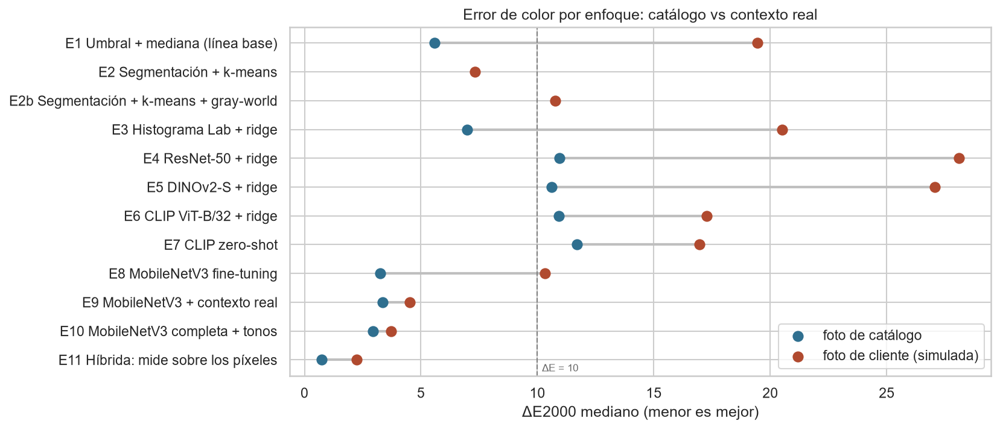
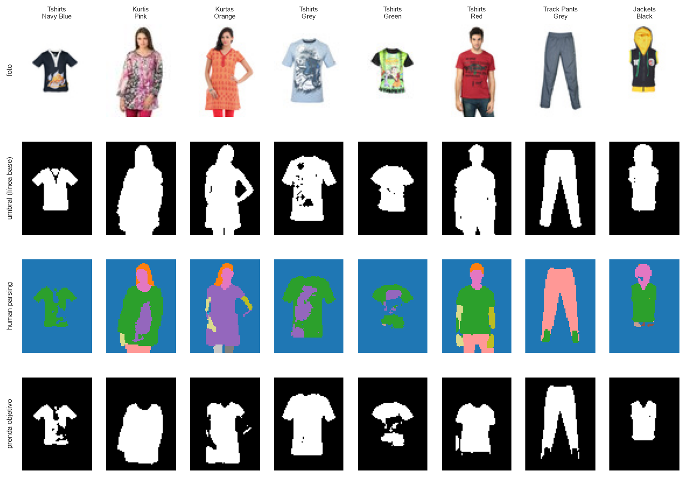
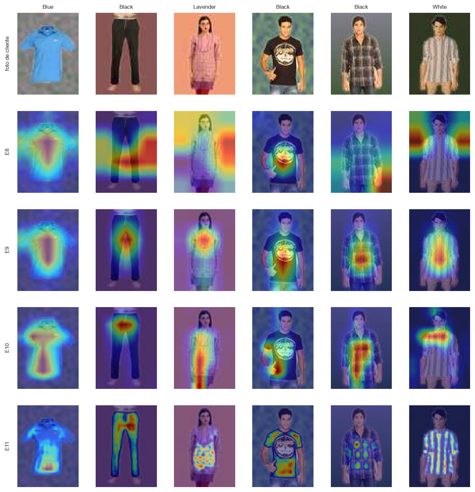

# Identificación automática del color de prendas para un catálogo de colorantes textiles

Proyecto del curso **Visión por Computador** (Universidad EAFIT), desarrollado con la metodología **CRISP-DM**.

**Autores:** Dilan Monsalve Monsalve · Juan David Trujillo Velez · David Botero Londoño · Isabel Jurado Jaramillo

A partir de una foto de una prenda, el sistema estima su **color en CIELAB continuo**, con su nombre de tono. Luego lo
compara por **ΔE2000** contra un catálogo de colorantes y sugiere las referencias más cercanas. No necesita máscara
manual ni fondo blanco.

**Resultado principal:** en fotos de cliente simuladas (otro fondo, otra luz y compresión JPEG), el modelo final E11
estima el color con un **ΔE2000 mediano de 2,2**. La medición directa por umbral, que es la línea base, da 19,5.



---

## 1. Problema de negocio

Una empresa de **colorantes para el sector textil** recibe en su área comercial requerimientos de color de varias
formas, y una de ellas son **fotos de prendas** que envían los clientes ("quiero este color"). Hoy un asesor revisa la
foto a ojo, busca en el catálogo una referencia parecida y la envía al laboratorio. Si el punto de partida está lejos, se
repiten pruebas de tinturado y la respuesta al cliente se demora.

**Objetivo:** dada una foto, estimar el color de la prenda y proponer las referencias del catálogo más cercanas, para
que el laboratorio arranque desde un mejor punto. El sistema **sugiere**; la igualación final sigue siendo de
laboratorio, porque el color en pantalla no es el del tinte sobre la fibra.

**Criterios de éxito**, definidos en la comprensión del negocio (notebook 01):

| Criterio | Meta |
|---|---|
| Grupo de color (13 grupos): accuracy / F1-macro | ≥ 90 % / ≥ 0,80 |
| Nombre de tono (46 tonos): top-1 / top-3 | ≥ 70 % / ≥ 90 % |
| Referencia del catálogo correcta entre las 3 sugeridas | ≥ 80 % |
| Error perceptual del color (ΔE2000) | lo menor posible; ΔE < 5 es «muy parecido» |

## 2. Datos

- **Fashion Product Images (small)**: 44.072 imágenes de 60 × 80 px con metadata (género, categoría, tipo de
  artículo, `baseColour` con 46 tonos, temporada, uso).
  - Fuente: Hugging Face [`ashraq/fashion-product-images-small`](https://huggingface.co/datasets/ashraq/fashion-product-images-small),
    espejo del [dataset de Kaggle](https://www.kaggle.com/datasets/paramaggarwal/fashion-product-images-dataset) de Param Aggarwal.
- **Alcance:** solo las **21.361 prendas** (`masterCategory = Apparel`), porque el negocio son tintes para sustrato
  textil.
- **Particiones:** 70/15/15, estratificadas por tono y **agrupadas por casi-duplicados** (dHash) para evitar fuga entre
  conjuntos (`data/intermedios/splits.csv`).
- **Catálogo de colorantes:** si la empresa aporta un CSV `referencia,L,a,b` en `data/catalogo_colorantes.csv`, la
  evaluación lo usa automáticamente. Si no, se simula un catálogo de 300 referencias que cubre el gamut textil observado.

## 3. Metodología (CRISP-DM)

| Etapa | Notebook | Contenido |
|---|---|---|
| 1-2. Comprensión del negocio y de los datos | [`01_comprension_negocio_y_datos`](notebooks/01_comprension_negocio_y_datos.ipynb) | Caso de negocio, criterios de éxito, EDA: calidad, duplicados, desbalance (1.940×), espacio de color CIELAB, solapamiento de tonos, sesgos y línea base |
| 2. Exploración complementaria | [`03_exploracion_complementaria`](notebooks/03_exploracion_complementaria.ipynb) | Nueve factores del dominio que alteran el color (iluminante, exposición, sombras, estampados, piel, fondo, JPEG, metamerismo…), relación del color con los metadatos (V de Cramér, Kruskal-Wallis) y análisis cualitativo |
| 3. Preparación | [`02_preparacion_datos`](notebooks/02_preparacion_datos.ipynb) | Segmentación de la prenda, balance de blancos, objetivo continuo, multicolor, coherencia de etiquetas y fotos de cliente simuladas |
| 4. Modelado | [`04_modelado`](notebooks/04_modelado.ipynb) | Once enfoques (E1–E11), funciones de costo y curvas de entrenamiento |
| 5. Evaluación | [`05_evaluacion`](notebooks/05_evaluacion.ipynb) | ΔE2000, nombre, catálogo, techo de la evaluación, criterios, robustez, equidad por metadatos, explicabilidad, errores y demostración |

### Del nombre discreto al color continuo

El dataset trae **clases discretas** (46 nombres de tono), pero un cliente puede pedir **cualquier color**. Por eso:

- **El objetivo es continuo:** es el color dominante de la prenda en CIELAB.
- **Cómo se mide:**
  1. **Segmentación de la prenda** con un modelo de *human parsing* preentrenado (SegFormer-B2, `mattmdjaga/segformer_b2_clothes`). La máscara por umbral de la línea base incluía un 45 % de píxeles que no eran la prenda (piel, cabello, otras prendas).
  2. **Balance de blancos de Von Kries**, con el fondo como referencia neutra.
  3. **k-means (k = 3) en Lab** sobre los píxeles de la prenda: el grupo con mayor participación es el color objetivo.
- **La etiqueta `baseColour`** ya no es la salida:
  - define un **prototipo por tono** (la mediana Lab);
  - **filtra incoherencias:** el prototipo de la etiqueta debe estar entre los 5 más cercanos al color medido. El 36 % del entrenamiento no lo cumple.
- **Prendas multicolor:**
  - Regla: el segundo color ocupa ≥ 25 % de la prenda y está a ΔE ≥ 20 del primero. Detecta la etiqueta `Multi` con AUC 0,80.
  - Para ellas se entrega la **paleta** completa.
- **Fotos de cliente simuladas:** 3.010 fotos de prueba con fondo aleatorio, iluminante de 3.000 a 7.500 K, exposición de 0,75 a 1,2 y JPEG de calidad 35 a 75. El objetivo no cambia: el modelo debe recuperar el color bajo luz neutra, es decir, debe tener **constancia de color**.



## 4. Modelos

| # | Enfoque | ¿Máscara al predecir? | Tema del curso |
|---|---|---|---|
| E1 | Umbral contra el fondo + mediana Lab (línea base) | Sí, por umbral | Visión clásica, espacios de color |
| E2 | Segmentación + k-means (± gray-world) | Sí, aprendida | Segmentación |
| E3 | Histograma Lab + ridge | No | Descriptores clásicos |
| E4 | ResNet-50 congelada + ridge | No | Transfer learning |
| E5 | DINOv2-S congelado + ridge | No | ViT auto-supervisado |
| E6 | CLIP ViT-B/32 congelado + ridge | No | Modelo fundacional |
| E7 | CLIP zero-shot (texto del tono → prototipo) | No | Zero-shot |
| E8 | MobileNetV3 fine-tuning (Lab + grupo) | No | Fine-tuning multitarea |
| E9 | E8 + aumento con contexto real (fondo y luz, objetivo fijo) | No | Aumento con criterio de dominio |
| E10 | Red completa, 224 × 168, cabeza de 46 tonos, más peso a L*, TTA | No | Fine-tuning completo |
| **E11** | **Híbrida: aprende *dónde* está el color y *qué luz* hay, y *mide* sobre los píxeles** | No (la aprende) | Segmentación + constancia de color + pérdida perceptual |

**E11, "medir en vez de adivinar"** ([`core/hibrida.py`](core/hibrida.py)):

- **Arquitectura:** un codificador MobileNetV3 y un decodificador FPN hasta la resolución nativa (80 × 60).
- **Qué predice:**
  1. un **mapa de atención** sobre los píxeles del color dominante;
  2. tres **ganancias por canal** que corrigen el iluminante (tipo Von Kries);
  3. un ajuste final pequeño.
- **Cómo da el color:** Lab(Σ w · e^g ⊙ RGB lineal). El color sale de una fórmula física sobre los píxeles reales.
- **Supervisión:** la atención aprende de la máscara del color dominante y las ganancias, de la luz simulada, que se conoce.
- **Entrenamiento:** pérdida **ΔE2000 diferenciable** (validada contra `skimage`), 40 épocas, y el mejor modelo se elige por ΔE2000 en validación con fotos de cliente.

**Por qué E11:** el análisis de errores de E10 mostró que una CNN con pooling global no puede escoger píxeles. Con la
máscara exacta el color se reproduce con ΔE 0,6, pero con la misma máscara a 1/4 de resolución ya da ΔE 3,8, que es el
error de E10. E11 resuelve justamente eso.

## 5. Resultados

ΔE2000 mediano frente al color medido, en las 1.806 prendas de test coherentes y de un color:

| Enfoque | Foto de catálogo | Foto de cliente (simulada) |
|---|---|---|
| E1 Umbral + mediana (línea base) | 5,6 | 19,5 |
| E2 Segmentación + k-means | — | 7,3 |
| E3 Histograma Lab + ridge | 7,0 | 20,5 |
| E4 ResNet-50 + ridge | 11,0 | 28,1 |
| E5 DINOv2-S + ridge | 10,6 | 27,1 |
| E6 CLIP + ridge | 10,9 | 17,3 |
| E7 CLIP zero-shot | 11,7 | 17,0 |
| E8 MobileNetV3 fine-tuning | 3,3 | 10,4 |
| E9 MobileNetV3 + contexto real | 3,4 | 4,5 |
| E10 MobileNetV3 completa + tonos | 3,0 | 3,7 |
| **E11 Híbrida** | **0,7** | **2,2** |

**Criterios de éxito con E11, en foto de cliente:**

| Criterio | Meta | Techo por prototipo* | E11 | ¿Cumple? |
|---|---|---|---|---|
| ΔE2000 mediano | — | — | **2,2** (86 % < 5; 98 % < 10) | — |
| Grupo (13): accuracy | ≥ 90 % | 75 % | 86 % | Casi |
| Grupo (13): F1-macro | ≥ 0,80 | 0,60 | 0,83 | Sí |
| Tono (46): top-1 | ≥ 70 % | 60 % | 80 % | Sí |
| Tono (46): top-3 | ≥ 90 % | 90 % | 97 % | Sí |
| Referencia equivalente a la vista en el top-3** | ≥ 80 % | 100 % | 88 % (exacta: 80 %) | Sí |

\* **Techo por prototipo:** lo que lograría un color *perfecto* si se nombra por el prototipo más cercano. Muestra que con
ese método las metas de nombre eran inalcanzables; por eso el nombre lo predicen cabezas de clasificación de la red.

\*\* En el catálogo simulado, la segunda referencia más cercana está a solo ΔE 1,1 de la primera, que es indistinguible
a la vista. Por eso se cuenta como acierto cualquier referencia a menos de 1 ΔE de la mejor posible.

**Robustez y explicabilidad:**
- Con luz cálida (3.000–4.000 K), E11 queda en ΔE 2,4, frente a 25 de la línea base.
- Con cualquier tipo de fondo, E11 queda en ΔE 2,2–2,3.
- No tiene sesgo de claridad.
- Su mapa de atención sigue el contorno de la prenda y evita estampados, piel y fondo. En cambio, el Grad-CAM de E8 muestra que esa red mira el fondo.



**Alcance honesto de las cifras:**
- En **todo** el test, incluidas prendas multicolor y etiquetas incoherentes, E11 da ΔE 2,7, 70 % de grupo y 60 % de tono.
- En prendas multicolor el ΔE sube a 6,0, porque un solo color no las describe; para ellas se entrega la paleta.
- El 0,7 en fotos de catálogo es casi una réplica del procedimiento de medición; la cifra relevante es la de foto de cliente.
- Con luz y máscara perfectas, el piso físico de esta simulación es ΔE ≈ 1,6.

## 6. Conclusiones y limitaciones

1. **El color continuo responde al negocio:** el cliente puede pedir cualquier color, y la etiqueta discreta solo sirve para nombrar y filtrar.
2. **La medición por umbral no sirve con fotos reales**, porque depende de un fondo blanco.
3. **El aumento de datos con iluminantes y fondos, manteniendo fijo el objetivo, enseña constancia de color** (E9–E11).
4. **Medir sobre los píxeles (E11) supera a regresar el color desde un vector global.** Cada mejora salió de medir primero dónde estaba el error: el techo del nombre llevó a E10 y la resolución de lectura llevó a E11.

**Limitaciones:**
- Las fotos de cliente y el catálogo son **simulados**: falta validar con requerimientos reales y medición de espectrofotómetro.
- Las imágenes son de 60 × 80 px.
- El grupo de color queda en 86 % (meta 90 %).
- La segmentación usada para la paleta falla en prendas sin persona sobre fondos con textura.

**Trabajo futuro:**
- Validar con datos reales.
- Pedir al cliente una hoja blanca en la foto como referencia de luz; se estima que permitiría ΔE ≈ 1,8.
- Usar imágenes de mayor resolución.
- Predecir la paleta completa con varios mapas de atención.

## 7. Estructura del repositorio

```
proyecto_tonos/
├── README.md
├── requirements.txt
├── descargar_datos.py          # descarga el dataset a data/raw/
├── ejecutar_pipeline.py        # cálculos pesados con caché: segmentación, objetivo, características, entrenamiento
├── core/                       # código del proyecto
│   ├── config.py               # rutas, parámetros, grupos de color y clases de prenda
│   ├── datos.py                # carga del parquet y decodificación de imágenes
│   ├── color.py                # descriptores de color del EDA, máscara por umbral, ΔE2000
│   ├── segmentacion.py         # SegFormer de prendas: máscara de la prenda objetivo
│   ├── objetivo_color.py       # balance de blancos, k-means Lab, multicolor, prototipos y coherencia
│   ├── perturbaciones.py       # fotos de cliente simuladas (fondo, iluminante, exposición, JPEG)
│   ├── preparacion.py          # tabla de prendas, particiones, fotos de cliente, máscaras dominantes
│   ├── caracteristicas.py      # histograma Lab, ResNet-50, DINOv2, CLIP
│   ├── modelos.py              # ridge, MobileNetV3 multitarea (E8–E10), Grad-CAM
│   ├── hibrida.py              # E11: atención + ganancias de luz + ΔE2000 diferenciable
│   ├── evaluacion.py           # ΔE2000, nombre por prototipo y por cabeza, catálogo y hit@k
│   └── exportar_presentacion.py
├── notebooks/                  # 01 a 05, ejecutados y con salidas
├── data/intermedios/           # cachés: particiones, segmentación, objetivo continuo, fotos de cliente
├── modelos/                    # pesos de E8–E11 (+ pesos ImageNet de MobileNetV3 para uso sin internet)
├── resultados/                 # predicciones, métricas, criterios, curvas y logs del pipeline
├── figuras/                    # figuras generadas por los notebooks
├── presentacion/               # presentaciones (PDF, HTML, PPTX) y guías de exposición
└── Tonos de color para colorantes textiles — Entrega final.pptx   # presentación de resultados (PowerPoint)
```

## 8. Cómo reproducir

**Requisitos:** Python 3.10 o superior.

1. **Entorno:**

   ```bash
   python -m venv venv
   venv\Scripts\pip install -r requirements.txt
   ```

   Para entrenar con GPU NVIDIA, instala antes PyTorch con CUDA
   (`pip install torch torchvision --index-url https://download.pytorch.org/whl/cu124`); el código detecta la GPU solo.

2. **Datos** (~260 MB):

   ```bash
   venv\Scripts\python descargar_datos.py
   ```

3. **Notebooks** en orden (`01` → `05`). El repositorio ya incluye las cachés de `data/intermedios/`, los modelos
   entrenados y las predicciones, así que los notebooks corren en CPU sin reentrenar nada.

4. **Opcional: recalcular todo desde cero.** Hay que borrar las cachés que se quieran regenerar y correr:

   ```bash
   venv\Scripts\python -u ejecutar_pipeline.py
   ```

   - En CPU tarda varias horas. Con una GPU (RTX 4060), el entrenamiento de E8–E11 toma unos 50 minutos.
   - La opción `--sin-entrenar` hace todo excepto el entrenamiento de las redes.

Los modelos preentrenados se descargan solos la primera vez desde Hugging Face y torchvision: SegFormer de prendas,
DINOv2-S, CLIP ViT-B/32 y ResNet-50. Los pesos de MobileNetV3 vienen incluidos en `modelos/pesos_preentrenados/`.

## 9. Presentaciones

En [`presentacion/`](presentacion/):
- **Comprensión del negocio y de los datos:** `entrega1_tonos_color.pdf`.
- **Presentación de resultados:** `entrega_final_tonos_color.pdf` (también en `.html`, y en `.pptx` en la raíz del repositorio).
